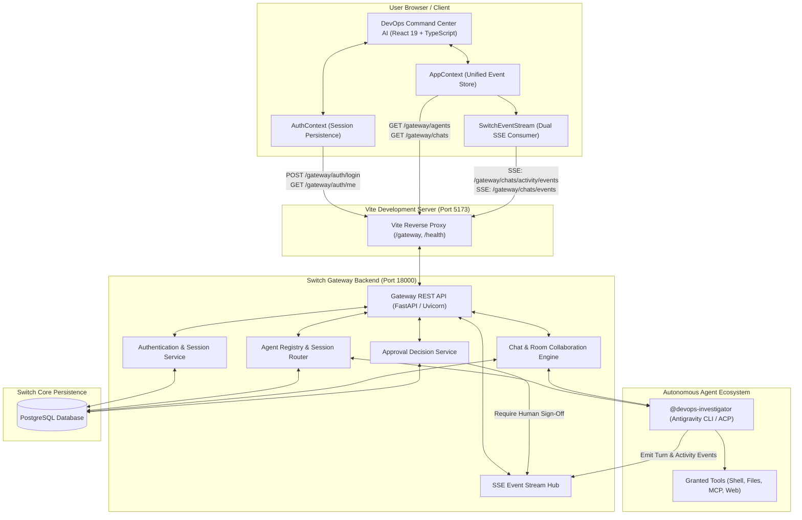
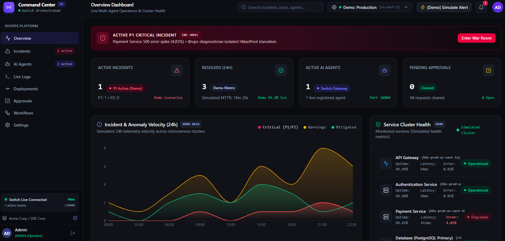
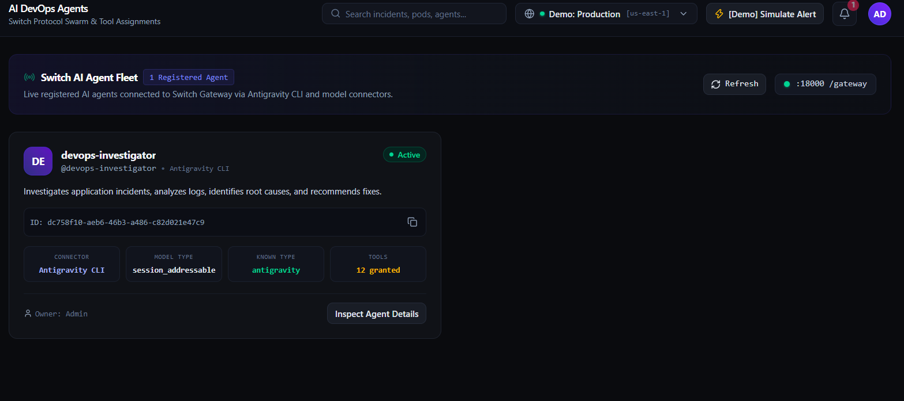
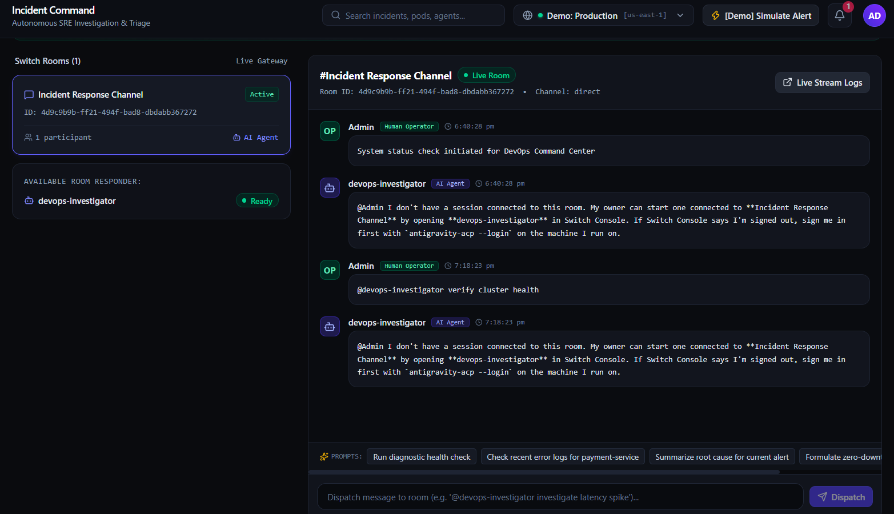
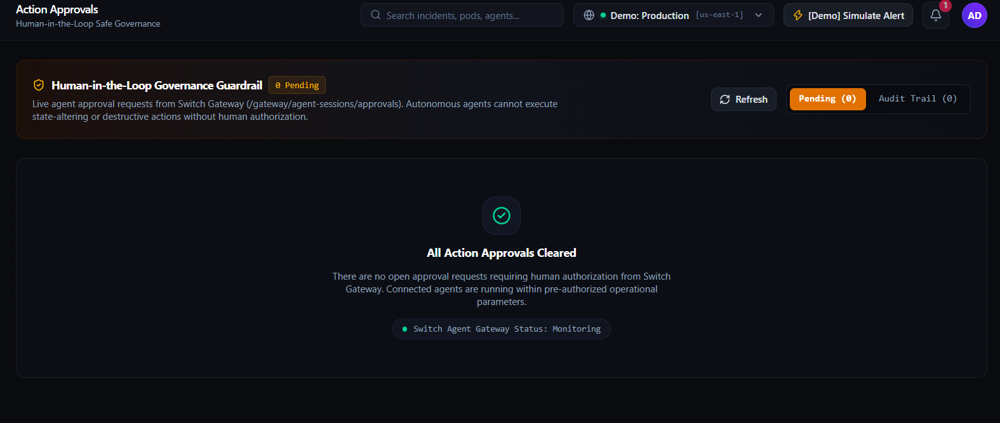
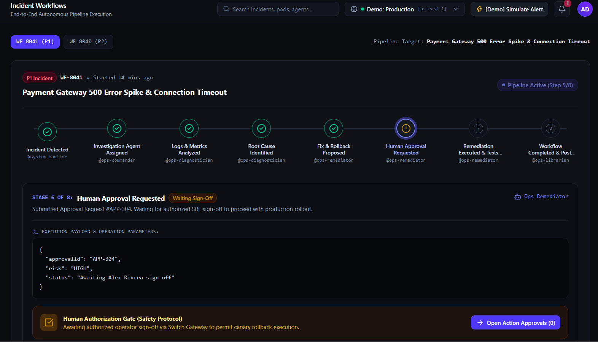
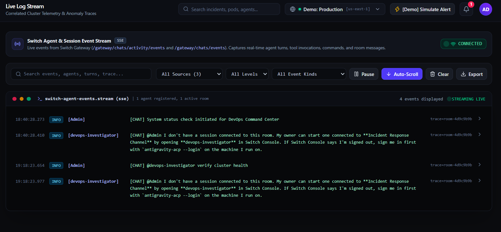

# DevOps Command Center AI

> **One Command Center. Intelligent Agents. Human-Controlled DevOps.**

A centralized operational dashboard and command center for AI-powered multi-agent incident management. DevOps Command Center AI bridges engineering teams and autonomous AI agents through real-time telemetry, live war-room collaboration, and human-in-the-loop approval workflows integrated with the Switch Gateway.

[](https://react.dev/)
[](https://www.typescriptlang.org/)
[](https://vite.dev/)
[](https://tailwindcss.com/)
[](https://github.com/its-anuraj/devops-command-center-ai)
[](https://developer.mozilla.org/en-US/docs/Web/API/Server-sent_events)
[](https://github.com/its-anuraj/devops-command-center-ai)

GitHub Repository: https://github.com/its-anuraj/devops-command-center-ai

## 🎥 Demo Video

Watch the project demonstration:

[▶ Watch DevOps Command Center AI – Demo Video](https://youtu.be/VT4aW0o_cmo)

Demonstration video showcasing Switch Gateway integration, AI agents, incident management, live events, and human-in-the-loop workflows.

---

## The Problem

Modern software engineering teams are rapidly adopting autonomous AI agents and language model tooling to diagnose bugs, query databases, and automate deployments. However, orchestrating these agents in operational environments presents severe challenges:

1. **Fragmented Agent Visibility**: Autonomous scripts, LLM tools, and subagents run in isolated terminals or background processes. Operations engineers lack a unified interface to inspect active agents, granted tools, connection models, or execution state.
2. **Lack of Centralized Telemetry**: When an agent investigates an issue or runs commands, telemetry is scattered across raw terminal stdout, local logs, and fragmented chat threads. SRE teams cannot reconstruct what an agent did, why it did it, or what steps failed.
3. **Delayed Incident Resolution**: Triaging production outages requires context-switching across monitoring dashboards, cloud consoles, incident channels, and CI/CD portals. Correlating errors with agent investigations is manual, slow, and error-prone.
4. **Poor Human-Agent Collaboration**: AI agents often operate as disconnected black boxes rather than active participants in engineering war rooms. Engineers cannot easily query agents, redirect investigations, or receive real-time reasoning updates inside an incident room.
5. **Uncontrolled Autonomous Actions**: Granting autonomous agents the authority to execute destructive shell commands, trigger rollbacks, or modify infrastructure without human oversight introduces unacceptable operational risk.

---

## Our Solution

**DevOps Command Center AI** addresses these challenges by providing a single, unified operational surface that connects human operators and autonomous agents under human oversight.

```
                    ┌───────────────────────────────────┐
                    │     DevOps Command Center AI      │
                    │   (Unified Operational Surface)   │
                    └─────────────────┬─────────────────┘
                                      │
         ┌────────────────────────────┼────────────────────────────┐
         ▼                            ▼                            ▼
┌──────────────────┐        ┌──────────────────┐        ┌──────────────────┐
│  Agent Discovery │        │   Live Stream    │        │  Human-in-Loop   │
│   & Fleet View   │        │ (War Room & SSE) │        │  Approval Gates  │
└──────────────────┘        └──────────────────┘        └──────────────────┘
```

- **Unified Agent Fleet Management**: Inspects the Switch Gateway registry to discover connected agents (e.g. `@devops-investigator` via Antigravity CLI), their granted tools, addressing policies, and execution statuses.
- **Persistent Dual-Stream SSE Telemetry**: Subscribes directly to Switch Gateway activity and chat event streams, rendering real-time turns, tool invocations, and system messages across all views without polling.
- **Interactive Incident War-Rooms**: Connects engineering operators directly to Switch chat channels, enabling live instruction dispatch, real-time agent turn streaming, and collaborative incident triage.
- **Human-in-the-Loop Safeguards**: Routes sensitive or risky remediation actions through an operator approval interface. Proposed remediation commands are never marked as executed without verified backend sign-off.
- **Data Honesty**: Strictly distinguishes genuine Switch Gateway backend data from demonstration scenario walkthroughs, ensuring zero confusion between real telemetry and simulated outage demonstrations.

---

## Key Features

### 1. Centralized Command Center Overview
- High-level KPI summary displaying live registered agent counts and active pending approvals retrieved directly from the Switch Gateway.
- Dual-mode timeline featuring a **Live Switch Stream** of real-time agent turns, tool calls, and approvals alongside an interactive walkthrough of a simulated P1 payments outage (`INC-8041`).
- Dynamic agent status monitoring (`ready`, `working`, `investigating`) driven by live Server-Sent Events.
- Explicitly labeled `DEMO DATA` anomaly velocity charts and simulated microservice cluster health indicators.

### 2. Switch Gateway Authentication & Session Security
- Full authentication integration with the Switch Gateway password login endpoint (`POST /gateway/auth/login`).
- Session persistence backed by secure, backend-issued HttpOnly session cookies (`switch_auth`) with 24-hour expiration.
- Client session validation via `GET /gateway/auth/me` with automatic redirect protection on unauthenticated routes.
- Clean logout lifecycle (`POST /gateway/auth/logout`) that immediately halts and disposes of active SSE streams and background intervals.

### 3. AI Agent Fleet Discovery & Tool Inspection
- Real-time agent synchronization consuming `GET /gateway/agents`.
- Detailed agent modal powered by `GET /gateway/agents/{id}`, displaying connector type (`Antigravity CLI`), connection model (`session_addressable`), assigned rooms, and complete granted tool inventories (`run_command`, `replace_file_content`, `grep_search`, `call_mcp_tool`, etc.).
- Honest empty and error states when no agents are registered or when the gateway is unreachable.

### 4. Real-Time Activity Monitoring & SSE Event Streams
- High-performance, dual-stream SSE client consuming `/gateway/chats/activity/events` and `/gateway/chats/events` concurrently.
- Exponential backoff reconnection loop (1s to 15s) with a 45-second heartbeat stall watchdog.
- In-memory notification and event deduplication (`seenNotificationIds`) preventing duplicate alerts across reconnects.
- Automatic stream termination upon session expiration or HTTP 401 status.

### 5. Interactive Incident War-Rooms
- Directly connected to active Switch collaboration channels (e.g. `Incident Response Channel` - ID `4d9c9b9b-ff21-494f-bad8-dbdabb367272`).
- Historical message pagination via `GET /gateway/chats/{roomId}/messages` augmented with real-time SSE chat streaming.
- **Interactive Operator Dispatch Console**: Transmits operator prompts (`POST /gateway/chats/{roomId}/messages`) directly to registered agents and streams agent responses live into the room.
- Quick DevOps prompt suggestions for rapid diagnostic queries.

### 6. Human-in-the-Loop Action Approvals
- Live synchronization with `GET /gateway/agent-sessions/approvals`.
- Real-time approval request cards displaying agent name, session ID, requested action, and risk classification.
- Interactive **Authorize** (`accept`) and **Reject** (`decline`) decision dispatch calling `POST /gateway/agent-sessions/{agent_id}/{session_id}/approvals/{request_id}/answer`.
- *Note on verification status*: The approval interface, UI cards, and API client bindings are implemented. However, live execution of the Accept and Reject actions has not yet been verified against an active request because the backend had zero open pending approvals during QA testing.
- Honest empty state when zero approval requests are pending, verifying that connected agents are operating within pre-authorized parameters.

### 7. Dual-Mode Incident Triage & Root Cause Analysis
- **Switch War-Rooms Tab**: Connects operators to real live communication channels and active agents.
- **Demo Scenarios Tab**: Detailed educational walkthroughs of realistic enterprise incidents (`INC-8041`, `INC-8040`, `INC-8039`) displaying automated root cause analysis (RCA), culprit git commits, HikariPool stack traces, and recommended remediation commands, clearly labeled `DEMO SCENARIOS`.

### 8. Autonomous Workflow Pipelines & Safety Boundaries
- **Live Switch Executions View**: Step-by-step telemetry of real agent turns, commands, and tool calls.
- **8-Stage Remediation Pipeline (Demo)**: Visual representation of an incident lifecycle from alert ingestion to post-mortem archival.
- **Strict Execution Boundary**: Stage 6 dynamically binds to the Switch approval state; Stage 7 explicitly enforces the rule that proposed destructive actions (e.g. deployment rollbacks) are **never marked as executed** without human authorization.

### 9. Switch Agent Events Live Stream
- Dedicated real-time log inspector streaming genuine Switch agent turns, tool calls, and room events.
- Client-side filtering by service, log level, event kind, and free-text search.
- Stream controls including Pause/Resume, Auto-scroll locking, and JSON export.

### 10. Deployment Pipeline & Settings
- Release history interface clearly labeled `DEMO DEPLOYMENTS` with rollback buttons strictly disabled to prevent simulated actions from claiming real infrastructure modifications.
- Operational settings overview displaying active Switch server parameters, endpoint health status, latency, and session details.

---

## Why This Project Is Different

| Dimension | Typical Hackathon Dashboard | DevOps Command Center AI |
|---|---|---|
| **Backend Integration** | Hardcoded mock data or local JSON files | **Genuine Switch Gateway integration** via REST API and live SSE streams on port 18000. |
| **Authentication** | Fake `localStorage` token or no auth | **HttpOnly cookie session authentication** validating against real backend users. |
| **Agent Telemetry** | Fabricated timer increments | **Real event streaming** consuming live activity and chat streams. |
| **Human Oversight** | Decorative "Approve" button with fake alerts | **Backend approval decision dispatch** posting decisions directly to agent sessions via Switch Gateway. |
| **Data Integrity** | Claims to manage real Kubernetes clusters | **Radically honest**: simulated scenarios are explicitly labeled `DEMO`; real backend data is uncompromised. |
| **Design Standard** | Generic Bootstrap/Material admin template | **Tailored dark command center** inspired by Linear, Vercel, and Grafana. |

---

## Architecture

The diagram below illustrates the actual data flow and system boundaries discovered and implemented across the stack:



---

## Technology Stack

| Technology | Version | Purpose in Project |
|---|---|---|
| **React** | 19.3.1 | Core UI library providing declarative rendering, state hooks, and component modularity. |
| **TypeScript** | 7.0.2 | Complete end-to-end type safety, domain model interfaces, and API contract enforcement. |
| **Vite** | 8.3.5 | High-speed frontend build tool and development server with integrated reverse proxy routing. |
| **Tailwind CSS** | 4.3.3 | Utility-first CSS styling engine powering the dark command center design system. |
| **React Router DOM** | 7.18.5 | Client-side routing, protected route guards, and deep-link navigation. |
| **Axios** | 1.21.0 | Promise-based HTTP client configured with credential forwarding and unified error handling. |
| **Recharts** | 3.10.1 | Composable SVG charting library for telemetry and incident velocity visualization. |
| **Lucide React** | 1.66.0 | Professional icon system for developer interfaces and operational indicators. |
| **Switch Gateway** | 0.31.0 | Underlying multi-agent coordination platform providing agent registry, rooms, and SSE streams. |
| **Server-Sent Events** | Native | High-efficiency unidirectional HTTP streaming protocol for real-time agent turns and chat. |
| **Oxlint** | 1.89.0 | High-performance Rust-based linter ensuring clean, maintainable frontend code. |

---

## Application Screenshots

### 1. Operational Command Center Overview

*Centralized operational dashboard showing real-time agent status, active approvals, live Switch event stream, and telemetry velocity metrics.*

### 2. AI Agent Fleet & Deep Inspection

*Live registry of connected Switch agents showing handles, connection models, and modal inspection of granted diagnostic tools.*

### 3. Incident War-Room Collaboration

*Real-time Switch collaboration channel featuring historical room messages, interactive prompt dispatch, and live agent turn streaming.*

### 4. Human-in-the-Loop Action Approvals

*Security approval gate displaying pending operational requests, risk classification, and audit history to prevent unauthorized destructive actions.*

### 5. Autonomous Workflow Remediation Pipeline

*Multi-stage remediation pipeline tracking alert triage through to post-mortem archival, with explicit human authorization enforcement at Stage 6.*

### 6. Switch Agent Events Live Stream

*High-throughput Server-Sent Events (SSE) telemetry inspector with real-time level filtering, search, and session trace correlation.*

---

## Getting Started

### Prerequisites

Ensure the following tools are installed on your machine:
- **Node.js**: v18.0.0 or later (Node.js 20+ recommended)
- **npm**: v9.0.0 or later
- **Switch Gateway**: A running Switch instance on `http://127.0.0.1:18000` (see Backend Verification below).

---

### Step 1: Clone the Repository

```bash
git clone https://github.com/its-anuraj/devops-command-center-ai.git
cd devops-command-center-ai
```

---

### Step 2: Install Frontend Dependencies

```bash
cd frontend
npm install
```

---

### Step 3: Configure Environment Variables

Create your local environment file using the provided `.env.example` template:

```bash
cp .env.example .env
```

Review `frontend/.env`:
```ini
# Switch Gateway API Base URL
# In development, the Vite proxy routes /gateway to http://127.0.0.1:18000/gateway
VITE_API_BASE_URL=/gateway
VITE_SWITCH_HEALTH_URL=/health
```

> **Note**: No backend secrets, API keys, or database credentials belong in `frontend/.env`.

---

### Step 4: Verify the Switch Gateway Backend

The Switch Gateway must be running and accessible on port `18000`. You can verify backend readiness by running:

```bash
curl -i http://127.0.0.1:18000/health/ready
```

Expected readiness response:
```json
{
  "status": "ready",
  "checks": {
    "database": {"healthy": true},
    "message_listener": {"healthy": true},
    "session_activity_listener": {"healthy": true},
    "agent_event_listener": {"healthy": true},
    "signal_bus": {"healthy": true}
  }
}
```

*(A basic liveness check is also available at `http://127.0.0.1:18000/health`, which returns `{"status":"ok"}`)*.

Verify the authentication configuration endpoint:
```bash
curl -i http://127.0.0.1:18000/gateway/auth/config
```

---

### Step 5: Start the Development Server

From the `frontend` directory, start the Vite development server:

```bash
npm run dev
```

The server will launch locally:
```
  VITE v8.3.5  ready in 280 ms

  ➜  Local:   http://localhost:5173/
  ➜  Network: use --host to expose
  ➜  press h + enter to show help
```

---

### Step 6: Log In to the Command Center

1. Open your browser and navigate to `http://localhost:5173`.
2. You will be redirected automatically to `/login`.
3. Enter the Switch Gateway admin credentials configured in your Switch deployment.
4. Upon successful sign-in, the secure HttpOnly cookie will be established, and you will be transitioned directly to the Command Center Overview.

---

## Environment Variables

All frontend configuration is managed via environment variables documented in `frontend/.env.example`:

| Variable Name | Purpose | Default / Example | Required |
|---|---|---|:---:|
| `VITE_API_BASE_URL` | Base path for Switch Gateway REST requests routed through the Vite proxy. | `/gateway` | **Yes** |
| `VITE_SWITCH_HEALTH_URL` | Endpoint path used to verify Switch Core root service health and readiness. | `/health` (or `/health/ready`) | No |

---

## Project Structure

The project directory tree represents the actual repository contents:

```
devops-command-center-ai/
├── README.md                      # Root documentation & architecture guide
├── .gitignore                     # Git ignore rules for node_modules, dist, .env
├── docs/                          # Project documentation assets
│   └── screenshots/               # Application UI screenshots
└── frontend/                      # React 19 + TypeScript frontend application
    ├── .env.example               # Safe environment variable configuration template
    ├── package.json               # Dependencies, scripts, and build metadata
    ├── vite.config.ts             # Vite configuration & backend proxy routing (/gateway, /health)
    ├── tsconfig.json              # TypeScript project reference configuration
    ├── tsconfig.app.json          # TypeScript application compiler options
    ├── tsconfig.node.json         # TypeScript Node/Vite compiler options
    ├── index.html                 # Single-page application entry HTML
    ├── public/                    # Static public assets (icons, favicons)
    └── src/
        ├── App.tsx                # Client routing & authentication boundary
        ├── main.tsx               # DOM bootstrap entry point
        ├── index.css              # Global styles and Tailwind CSS imports
        ├── context/
        │   ├── AuthContext.tsx    # Session validation, login, and logout state
        │   └── AppContext.tsx     # Centralized SSE lifecycle & unified event store
        ├── services/
        │   ├── apiClient.ts       # Axios instance with proxy base URL & credentials
        │   ├── switchGateway.ts   # Strongly typed Switch Gateway API bindings
        │   └── switchEventStream.ts # Dual-stream SSE consumer with stall watchdog
        ├── types/                 # TypeScript domain interfaces
        │   ├── agent.ts           # AI agent data models
        │   ├── approval.ts        # Human approval requests and decision contracts
        │   ├── incident.ts        # Incident triage and RCA schema
        │   ├── log.ts             # Live stream log event structure
        │   ├── workflow.ts        # Multi-stage remediation pipeline definitions
        │   ├── deployment.ts      # Release and canary deployment models
        │   └── service.ts         # Service health status types
        ├── pages/                 # Full-page views
        │   ├── LoginPage.tsx      # Gateway session sign-in form
        │   ├── OverviewPage.tsx   # Centralized operational command center
        │   ├── AgentsPage.tsx     # AI agent fleet discovery and tool inspector
        │   ├── IncidentsPage.tsx  # Switch War-Rooms & demo incident triage
        │   ├── ApprovalsPage.tsx  # Real-time human-in-the-loop sign-off console
        │   ├── WorkflowsPage.tsx  # Live execution telemetry & 8-stage pipeline
        │   ├── LogsPage.tsx       # Switch Agent Events live stream viewer
        │   ├── DeploymentsPage.tsx# Release tracking & canary monitoring (Demo)
        │   └── SettingsPage.tsx   # Operational server telemetry & connection parameters
        ├── components/            # Reusable UI component library
        │   ├── common/            # Badges, Buttons, Cards, Modals
        │   ├── layout/            # Navigation sidebar, Header, App layout
        │   ├── auth/              # Protected route guard
        │   └── overview/          # KPI cards, charts, grids, timelines
        └── data/                  # Educational demo scenario assets (labeled DEMO)
            ├── mockIncidents.ts
            ├── mockWorkflows.ts
            ├── mockDeployments.ts
            ├── mockLogs.ts
            └── mockServices.ts
```

---

## Security & Responsible AI

DevOps Command Center AI implements operational safety principles to ensure that agentic AI serves as a powerful assistant under human control:

- **HttpOnly Cookie Authentication**: Passwords and session tokens are never stored in client-accessible storage (`localStorage`, `sessionStorage`). Authentication utilizes browser-managed HttpOnly cookies (`switch_auth`), reducing token exfiltration risks.
- **Zero Secrets in Client Code**: The frontend codebase contains zero hardcoded API keys, database credentials, or private certificates.
- **Human-in-the-Loop Gates**: Actions requiring operational risk mitigation (such as rollbacks or modifying commands) are designed to route through the Approvals interface before execution. *(Live decision execution pending verification once an active approval request is generated)*.
- **Execution Boundaries**: Proposed remediation plans are strictly prevented from reporting false success. An action is held in `PENDING` status until verified backend execution telemetry is received.
- **Data Transparency**: Simulated scenario assets are explicitly badged (`DEMO SCENARIOS`, `DEMO DATA`, `DEMO PIPELINE`), ensuring operators always know whether they are inspecting genuine live telemetry or an educational demonstration.

---

## Current Limitations

In the spirit of complete technical transparency:
1. **Live Approval Decision Execution**: The Approvals page connects to the live Switch approval endpoint (`GET /gateway/agent-sessions/approvals`) and implements the decision answer endpoint (`POST /gateway/agent-sessions/{agent_id}/{session_id}/approvals/{request_id}/answer`). However, because the backend returned zero open pending approvals during testing (`[]`), live execution of the Accept and Reject actions has not yet been verified against an active request.
2. **External CI/CD Webhooks**: Automated rollback execution from the Deployments interface is disabled because external CI/CD platforms (e.g. ArgoCD, GitHub Actions) are not connected to this local instance.
3. **Cluster Metrics**: CPU and Memory velocity graphs and SLA metrics are simulated models designed to demonstrate UI telemetry integration, as raw Kubernetes metric server streams require dedicated cluster agents.
4. **Third-Party Messaging Bridges**: Mattermost integration in Switch chat rooms depends on the active state of optional local Mattermost Docker containers.

---

## Roadmap

Planned enhancements for future development cycles:

- [ ] **Native Kubernetes & Prometheus Exporters**: Ingest live cluster metrics, pod crash counts, and node utilization directly into the overview timeline.
- [ ] **Bidirectional MCP Tool Inspector**: Real-time visualization of Model Context Protocol (MCP) tool schema requests and structured returns.
- [ ] **Multi-Tenant Approval Policies**: Granular role-based sign-off thresholds (e.g. two SRE approvals required for P1 database migrations).
- [ ] **Automated Post-Mortem Archival**: Automatically compile incident war-room conversation history, stack traces, and executed commands into structured Markdown incident post-mortems.
- [ ] **Automated Canary Rollback Validation Harness**: Connect directly to Argo Rollouts or Flux to automate and monitor progressive traffic shifts upon approved remediations.

---

## Hackathon Submission

Project Name: DevOps Command Center AI
Repository: [GitHub Repository](https://github.com/its-anuraj/devops-command-center-ai)
Author / Developer: Anuraj Singh ([@its-anuraj](https://github.com/its-anuraj))
Category: AI-powered DevOps / Agentic AI / Developer Tools / Incident Management
Demo Video: [Watch Demo](https://youtu.be/VT4aW0o_cmo)

---

## Contributing & License

### Contributing
Contributions, bug reports, and suggestions are welcome!
1. Fork the repository.
2. Create a feature branch (`git checkout -b feature/amazing-feature`).
3. Commit your changes with clear messages (`git commit -m 'Add amazing feature'`).
4. Ensure the production build and linter pass (`npm run build && npm run lint`).
5. Push to your branch (`git push origin feature/amazing-feature`).
6. Open a Pull Request.

### License
No license has been added yet. All rights reserved by the author.
